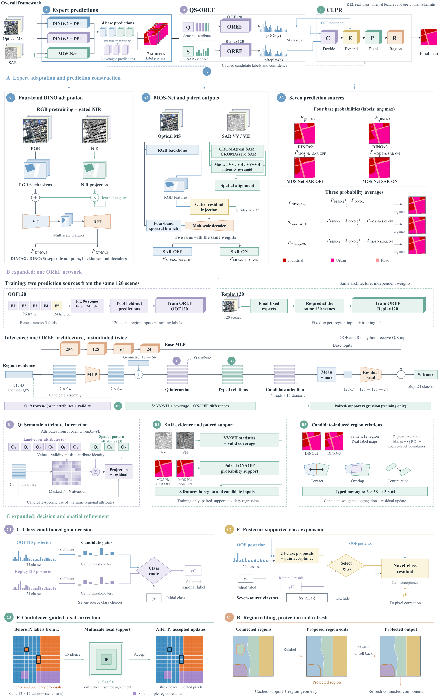
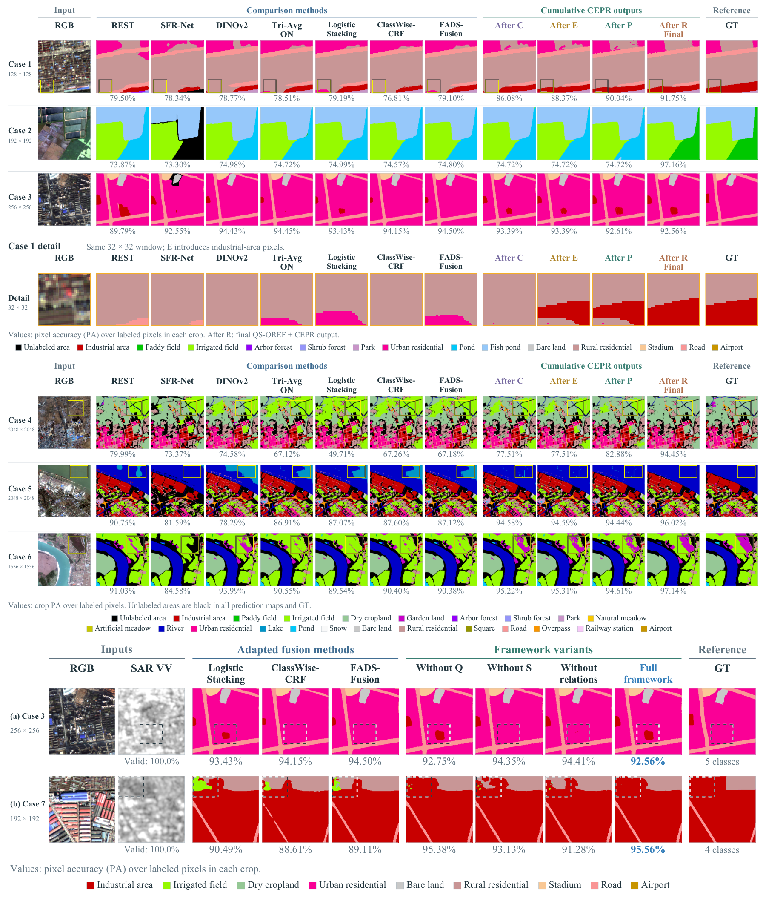

<h1>OREFine</h1>

<strong>Object-Relational Evidence Fusion for Multi-Expert 
Multimodal Remote Sensing Semantic Segmentation</strong>

## Contents

- [1. Overview](#overview)
- [2. Model Zoo](#model-zoo)
- [3. Qualitative Results](#qualitative-results)
- [4. Datasets](#datasets)
- [5. Third-party Models](#third-party-models)
- [6. Runtime Environment](#runtime-environment)
- [7. FBP Code](#fbp-code)

## 1. Overview

OREFine fuses predictions from DINOv2, DINOv3, and MOS-Net using object-relational evidence, then refines the segmentation through class decisions and spatial correction.

## 2. Model Zoo

FBP, WHU-OPT-SAR, and DFC2020 checkpoints are available on [Hugging Face](https://huggingface.co/miaokiyama/OREF-CEPR/tree/main). Checkpoints for the remaining datasets are being prepared for release.

### 2.1 Five-Billion-Pixels

| Model | Backbone | mIoU (%) ↑ | Download |
| :--- | :--- | ---: | :---: |
| DINOv2 | ViT-L/14 | 73.2480 | [Download](https://huggingface.co/miaokiyama/OREF-CEPR/resolve/main/FBP_DINOv2_L.pth?download=true) |
| DINOv3 | ViT-L/16 | 73.1420 | [Download](https://huggingface.co/miaokiyama/OREF-CEPR/resolve/main/FBP_DINOv3_L.pth?download=true) |
| MOS-Net | ConvNeXt-L + CROMA-Base | 73.1130 | [Download](https://huggingface.co/miaokiyama/OREF-CEPR/resolve/main/FBP_MOSNet.pth?download=true) |
| **OREFine** | DINOv2-L + DINOv3-L + MOS-Net | **83.0964** | [Download](https://huggingface.co/miaokiyama/OREF-CEPR/resolve/main/FBP_QS_OREF_CEPR.pth?download=true) |

### 2.2 WHU-OPT-SAR

| Model | Backbone | mIoU (%) ↑ | Download |
| :--- | :--- | ---: | :---: |
| DINOv2 | ViT-L/14 | 57.8354 | [Download](https://huggingface.co/miaokiyama/OREF-CEPR/resolve/main/WHU_DINOv2_L.pth?download=true) |
| DINOv3 | ViT-L/16 | 56.7036 | [Download](https://huggingface.co/miaokiyama/OREF-CEPR/resolve/main/WHU_DINOv3_L.pth?download=true) |
| MOS-Net | ConvNeXt-L + CROMA-Base | 56.6654 | [Download](https://huggingface.co/miaokiyama/OREF-CEPR/resolve/main/WHU_MOSNet.pth?download=true) |
| **OREFine** | DINOv2-L + DINOv3-L + MOS-Net | **60.86518** | [Download](https://huggingface.co/miaokiyama/OREF-CEPR/resolve/main/WHU_QS_OREF_CEPR.pth?download=true) |

### 2.3 DFC2020

| Model | Backbone | mIoU (%) ↑ | Download |
| :--- | :--- | ---: | :---: |
| DINOv2 | ViT-L/14 | 41.9554 | [Download](https://huggingface.co/miaokiyama/OREF-CEPR/resolve/main/DFC2020_DINOv2_L.pth?download=true) |
| DINOv3 | ViT-L/16 | 42.2715 | [Download](https://huggingface.co/miaokiyama/OREF-CEPR/resolve/main/DFC2020_DINOv3_L.pth?download=true) |
| MOS-Net | ConvNeXt-L + CROMA-Base | 43.4693 | [Download](https://huggingface.co/miaokiyama/OREF-CEPR/resolve/main/DFC2020_MOSNet.pth?download=true) |
| **OREFine** | DINOv2-L + DINOv3-L + MOS-Net | **44.8655** | [Download](https://huggingface.co/miaokiyama/OREF-CEPR/resolve/main/DFC2020_QS_OREF_CEPR.pth?download=true) |

### 2.4 Hunan

| Model | Backbone | mIoU (%) ↑ | Download |
| :--- | :--- | ---: | :---: |
| DINOv2 | ViT-L/14 | 54.1203 | Coming soon |
| DINOv3 | ViT-L/16 | 51.7484 | Coming soon |
| MOS-Net | ConvNeXt-L + CROMA-Base | 53.5533 | Coming soon |
| **OREFine** | DINOv2-L + DINOv3-L + MOS-Net | **57.0560** | Coming soon |

*Models for additional datasets are being organized and will be added here.*

## 3. Qualitative Results

## 4. Datasets

### 4.1 Our Co-registered SAR Data

> **FBP-128SAR**
>
> We provide **SAR data co-registered with Five-Billion-Pixels (FBP)** for optical–SAR semantic segmentation.
>
> **[Download FBP-128SAR on Hugging Face](https://huggingface.co/datasets/miaokiyama/FBP-128SAR/tree/main)**

### 4.2 Dataset Downloads

| Dataset | Download |
| :--- | :---: |
| Five-Billion-Pixels (FBP) | [Download](https://x-ytong.github.io/project/Five-Billion-Pixels.html) |
| WHU-OPT-SAR | [Download](https://github.com/AmberHen/WHU-OPT-SAR-dataset) |
| DFC2020 | [Download](https://ieee-dataport.org/competitions/2020-ieee-grss-data-fusion-contest) |
| Hunan | [Download](https://github.com/LauraChow/HunanMultimodalDataset) |
| CERRA | [Download](https://github.com/ai4luc/CerraData-4MM#data-downloading) |
| MultiSenGE | [Download](https://zenodo.org/records/6375466) |
| C2Seg-AB | [Download](https://github.com/danfenghong/RSE_Cross-city) |
| C2Seg-BW | [Download](https://github.com/danfenghong/RSE_Cross-city) |
| GID-5 | [Download](https://x-ytong.github.io/project/GID.html) |
| Potsdam | [Download](https://www.isprs.org/resources/datasets/benchmarks/UrbanSemLab/2d-sem-label-potsdam.aspx) |
| Vaihingen | [Download](https://www.isprs.org/resources/datasets/benchmarks/UrbanSemLab/2d-sem-label-vaihingen.aspx) |

## 5. Third-party Models

We use **Qwen3.5-9B** to generate visual attribute observations (Q) from optical imagery. The upstream models used in this repository are listed below; their original code/model terms remain applicable.

| Model | Source |
| :--- | :--- |
| Qwen3.5-9B | [Hugging Face](https://huggingface.co/Qwen/Qwen3.5-9B) |
| DINOv2 | [GitHub](https://github.com/facebookresearch/dinov2) |
| DINOv3 / ConvNeXt | [GitHub](https://github.com/facebookresearch/dinov3) |
| CROMA | [GitHub](https://github.com/antofuller/CROMA) |

Vendored CROMA and DINOv3 ConvNeXt license files are included beside their source
in `oref_cepr/legacy/vendor/`. Model weights and datasets are downloaded
separately. This release does not assign a new blanket license to third-party
code, weights or datasets.

## 6. Runtime Environment

### 6.1 Segmentation and Fusion

The following configuration was used to validate the WHU and DFC2020 inference releases.

| Component | Tested configuration |
| :--- | :--- |
| Operating system | Linux (x86-64) |
| Python | 3.10.20 |
| PyTorch / torchvision | 2.4.1 / 0.19.1 |
| PyTorch CUDA build | 11.8 |
| GPU used for validation | NVIDIA GeForce RTX 3090 (24 GB) |
| C++ compiler | g++ 7.5.0, with C++17 support |
| [timm](https://github.com/huggingface/pytorch-image-models) | 1.0.28 |
| NumPy / SciPy | 1.26.4 / 1.13.1 |
| Pillow (WHU) | 12.3.0 |
| einops / PyYAML | 0.8.2 / 6.0.3 |
| Rasterio (DFC2020) | 1.4.4 |

### 6.2 Qwen Observation Extraction

Q observations are generated in a separate environment. The verified Qwen configuration uses Python 3.10.20, PyTorch 2.4.1 and CUDA 11.8, with:

| Component | Tested configuration |
| :--- | :--- |
| Model | Qwen3.5-9B |
| Transformers | 5.3.0 |
| Accelerate | 1.10.1 |
| Precision / attention | BF16 / SDPA |

Qwen is needed when generating Q observations; inference bundles that include cached Q observations use those observations directly.

## 7. FBP Code

| Part | Code |
| --- | --- |
| 1 | [DINOv2 / DINOv3 training](01_dino_training/) |
| 2 | [MOS-Net training](02_mos_training/) |
| 3 | [Five-fold training and OOF prediction](03_fivefold_training/) |
| 4 | [Qwen observation generation](04_qwen_observations/) |
| 5 | [QS-OREF training](05_oref_training/) |
| 6 | [CEPR](06_cepr/) |
| 7 | [Final model inference](07_final_inference/) |

Start with the [FBP guide](docs/FBP.md). See [validation](docs/VALIDATION.md) for the checks performed on this release.
